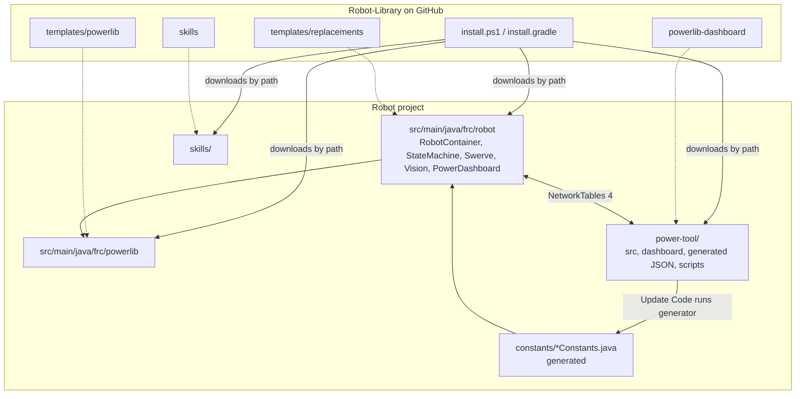

# Architecture

Robot-Library is **not a Gradle dependency**. It's a repo of source files that an installer copies
into each robot project, plus a desktop app (Power Tool) that runs from inside that project.

## Repo layout
```text
Robot-Library/
├── install.ps1, install.gradle      installer (→ 02-Install-and-Update)
├── generate-subsystem.ps1           JSON → Java generator
├── update-power-tool.ps1, build-dashboard*.ps1   Power Tool install/update/packaging
├── templates/
│   ├── powerlib/   frc.powerlib.*   reusable library, always overwritten on install (→ 03-PowerLib)
│   ├── replacements/ frc.robot.*    starter robot code, owned by the team after install (→ 04-Robot-Templates)
│   └── vendordeps/                  pinned MapleSim vendordep
├── powerlib-dashboard/              Power Tool: Electron + React (→ 05-Power-Tool)
├── skills/                          agent skills copied into robot projects (→ 08-Skills)
├── tests/                           Java + PowerShell + Node checks (→ 07-Testing)
└── Power-Tool-AGENTS/               this vault (repo-only, never installed)
```

## How it fits together in a robot project


## The five parts
1. **Installer:** puts everything in place and keeps the team's own edits safe on re-install (`.template` copies). [Installer Flow](../02-Install-and-Update/Installer%20Flow.md)
2. **PowerLib (`frc.powerlib`):** mechanisms, configs, telemetry, tuning, vision, autos, state handlers. [PowerLib index](../03-PowerLib/INDEX.md)
3. **Robot templates (`frc.robot`):** wire PowerLib into a working swerve robot. [Robot Templates](../04-Robot-Templates/Robot%20Templates.md)
4. **Power Tool:** a desktop dashboard that edits subsystems and constants, runs the generator, shows live telemetry and handles tuning. [Power Tool Architecture](../05-Power-Tool/Power%20Tool%20Architecture.md)
5. **Skills:** agent workflows such as MapleSim setup. [powerlib-sim Skill](../08-Skills/powerlib-sim%20Skill.md)

## The connections that matter
| Link | Mechanism | Note |
|---|---|---|
| Robot → Power Tool telemetry | NT `/PowerLib/Data` JSON, 10 Hz | [Telemetry Flow](../06-Data-Flows/Telemetry%20Flow.md) |
| Robot → log files | CTRE SignalLogger, 50 Hz | [Telemetry and Logging](../03-PowerLib/Telemetry%20and%20Logging.md) |
| Power Tool ↔ Robot tuning | NT `/PowerLib/Tuning/*`, `.../Variables/*`, 5 Hz | [Tuning Round Trip](../06-Data-Flows/Tuning%20Round%20Trip.md) |
| Power Tool → Java | JSON in `power-tool/generated/`, then `generate-subsystem.ps1` | [Code Generation Flow](../06-Data-Flows/Code%20Generation%20Flow.md) |
| Cameras → pose | Limelight NT tables, then the PowerLib vision stack, then the Swerve estimator | [Vision to Pose Flow](../06-Data-Flows/Vision%20to%20Pose%20Flow.md) |

Related: [Glossary](Glossary.md), [Home](../README.md)
