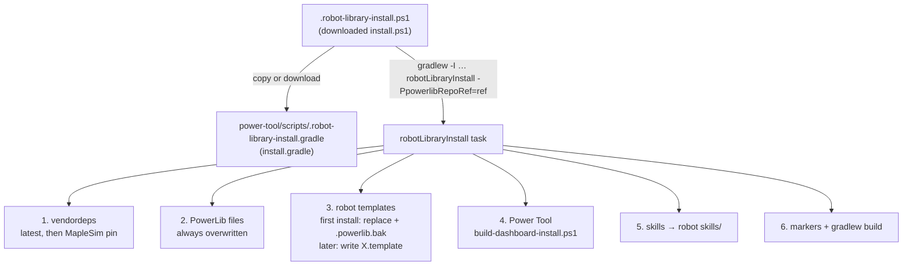

# Installer Flow

You run this once in a fresh WPILib Java project, and again later to update. It installs
PowerLib, the robot templates, skills, vendordeps and Power Tool. User-facing docs: `README.md`
and `INTERNAL.md` at the repo root.

## `install.ps1` (58 lines)
- Params: `-RepoRef` (default `main`), `-InstallerUrl`, `-KeepInstaller`. Everything else passes through to Gradle as `-P…` flags.
- Needs `gradlew` in the current folder. It copies or downloads `install.gradle` from `raw.githubusercontent.com/FRC9410/Robot-Library/<ref>/install.gradle` and runs `gradlew --no-daemon --console=plain -I <it> robotLibraryInstall`.
- Deletes the temp Gradle file and itself unless `-KeepInstaller` is passed.

## `install.gradle` (Gradle init script, ~980 lines)
- **File manifest:** a hard-coded `templateFiles` list (around lines 19-401) of `TemplateFile {source, destination, replacement, createOnly}`.
  - `source` starting with `powerlib/` = library file; anything else = template.
  - **Adding a new `templates/powerlib/**/*.java` file? Add it to this list.** `tests/generator-checks.ps1` fails otherwise.
- **Downloads:** each file is fetched by explicit path from `raw.githubusercontent.com/.../<ref>/templates/<source>`. That's why this vault and other repo-only folders never reach robot projects.
- **Library files** (`frc.powerlib`): always overwritten, no backup. Deprecated `PositionSubsystem*` files are deleted.
- **Template files** (`frc.robot`):
  - A project counts as already installed if any of `.powerlib-installed`, `StateMachine.java` or `PowerDashboard.java` exists.
  - **First install:** overwrite. `replacement:true` files get a `.powerlib.bak` backup, which is deleted at the end unless `-PpowerlibKeepBackups=true`.
  - **Later installs:** the user's file is kept and the new version is written beside it as `X.template`.
  - **Exceptions:**
    - `RobotAutos.java` is `createOnly`: never overwritten, no `.template`.
    - `RobotContainer`/`PowerDashboard` are force-replaced (with backup) if they're too old: missing `implements PowerRobotContainer` or the raw-NT tables.
- **Vendordeps:** ChoreoLib, PathPlannerLib, MapleSim, Phoenix 6 replay and Phoenix 5 replay are downloaded at their latest versions. Then the MapleSim pin `templates/vendordeps/maple-sim-0.4.0-beta.json` replaces the latest one (same uuid/name), unless `-PpowerlibLatestVendordeps=true`.
- **Markers written:** `.powerlib-installed` and `.powerlib-repo-ref`. The latter is read later by Power Tool's update actions.
- **Build check:** `gradlew build` in a fresh process unless `-PpowerlibSkipBuild=true`.

## Flags

| Flag | Default | Notes |
|---|---|---|
| `powerlibRepoRef` | `main` | Branch to pull from |
| `powerlibInstall` | true | Prompted: "Install PowerLib?" (lib + templates + skills) |
| `powerlibInstallLib` / `InstallTemplates` / `InstallSkills` | = `powerlibInstall` | Targeted overrides |
| `powerlibInstallVendordeps` | true | Prompted |
| `powerlibInstallTools` / `InstallDashboard` | true | Prompted: "Install Power Tool?" |
| `powerlibInteractive` | true | false = no prompts |
| `powerlibKeepBackups` | false | |
| `powerlibLatestVendordeps` | false | Skip the MapleSim pin |
| `powerlibSkipBuild` | false | |

## Gotchas found while documenting
- **Local checkout mode** only fully works when Gradle runs the repo's own `install.gradle` with `-I`, as `tests/generated-robot-check.ps1` does. Through `install.ps1`, missing local templates fall back to GitHub downloads.
- The Power Tool source zip URL is `.../archive/refs/heads/<ref>.zip`, so **tags don't work**, even though the README implies they do.
- "Kept a .powerlib.bak backup" is logged on forced replacement, but the backup is still deleted unless `-PpowerlibKeepBackups=true`.
- The README's file lists are incomplete. [Robot Templates](../04-Robot-Templates/Robot%20Templates.md) and [PowerLib Overview](../03-PowerLib/INDEX.md) have the full lists.

Related: [Power Tool Update Flow](Power%20Tool%20Update%20Flow.md), [Subsystem Generator](Subsystem%20Generator.md), [Robot Templates](../04-Robot-Templates/Robot%20Templates.md), [Architecture](../01-Overview/Architecture.md)
