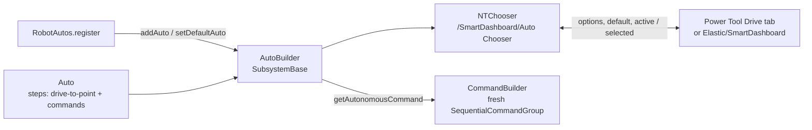

# Autonomous

Folder: `templates/powerlib/src/main/java/frc/powerlib/auto/`. Your routines go in the template
`autos/RobotAutos.java`. The installer creates it once and never overwrites it.

- **`Auto`:** one routine as ordered steps.
  - `addDriveToPoint(pose)`, or `withPath(poses…)` + `toNextPoint()`, plus `addCommand(() -> cmd)`.
  - `withAlliance(...)` filters the routine out of the chooser for the other alliance. It does **not** mirror coordinates.
  - All path points must be consumed. Steps are copied when the routine is registered.
- **`AutoBuilder`:** the registry.
  - `"None"` is always registered as the default. Duplicate names throw.
  - Drive steps need the `AutoBuilder(Function<Pose2d, Command> driveToPoint)` constructor. The template uses the no-arg one, which only supports command-only routines.
  - `publish()` once at startup. `periodic()` refreshes alliance filtering and `active`.
  - `getAutonomousCommand()` builds fresh commands every time.
- **`NTChooser`:** a SmartDashboard-compatible String Chooser written with raw NT.
  - Entries: `.type = "String Chooser"`, `.controllable`, `options`, `default`, `active` (robot), `selected` (dashboard).
  - Unknown or stale selections fall back to the default.
- **`CommandBuilder`:** `command(supplier)`, `runOnce(...)`, `waitSeconds(...)`, `build()`.

Usage examples: the "Autonomous Chooser" section of `README.md`. Tests: `AutoTest`, `AutoBuilderTest`.

Related: [State Machine and Controls](State%20Machine%20and%20Controls.md), [Tabs and Features](../05-Power-Tool/Tabs%20and%20Features.md), [Robot Templates](../04-Robot-Templates/Robot%20Templates.md)
