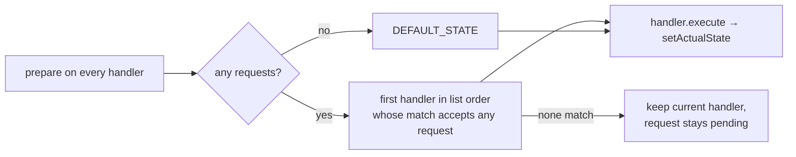

# State Machine and Controls

How driver buttons and autos ask the robot to do things. The interface is in PowerLib; the
`StateMachine` itself is a robot template.

## Pieces
- **`frc.powerlib.statemachine.State<R extends Enum<R>, M>`:** a state handler.
  - `match(requested, machine)`: can I run this request now?
  - `execute(requested, machine)`: runs each cycle while active and reports the actual state.
  - Optional `prepare(machine)`: refresh inputs every cycle; no hardware.
  - Optional `reset()`: clear behavior on a mode change. (The template never calls it.)
- **Template `StateMachine`** (`templates/replacements/.../subsystems/StateMachine.java`):
  - holds `enum RobotState {IDLE}`;
  - stores requests per **owner** in a `LinkedHashMap`;
  - keeps the `states` handler list, where **list order is priority**.
- **Template `IdleState`:** matches `IDLE` and reports it.
- **Template `RequestState` command:** an instant command that calls `requestState(state, owner)`.
- **`frc.powerlib.controls.ButtonBindings`:**
  - `bindStates(trigger, pressState, releaseState, stateMachine::requestState)` makes one stable owner per button, so releasing one button doesn't clobber another's request.
  - `bindFunctions(trigger, onPress, onRelease, reqs…)` binds plain press/release actions.
  - `bindFunctions(trigger, onPress, runWhenDisabled)` is press-only and can run while disabled.

## Each loop

- **First loop:** `activeState` starts as the first handler in the list, and the first loop skips choosing (no requests, and requested = current = `IDLE`). As shipped, with only `IdleState`, that's correct. **If you put another handler before Idle**, also set `requestsChanged = true` so the robot doesn't start in that handler. See [Adding a Robot State](../10-Guides/Adding%20a%20Robot%20State.md).
- `getWantedState()` = the resolved request; `getActualState()` = what the handler reports. Both go to telemetry as `Drive/RequestedState` and `Drive/ActualState`.
- `SwerveDriveCommand` gets `stateMachine::getCurrentState`, so it always reads live state.
- Full rules: the "Robot states" section of `README.md`. Tested by `tests/state-machine-check.ps1`.

Related: [Autonomous](Autonomous.md), [Robot Templates](../04-Robot-Templates/Robot%20Templates.md), [Telemetry and Logging](Telemetry%20and%20Logging.md)
