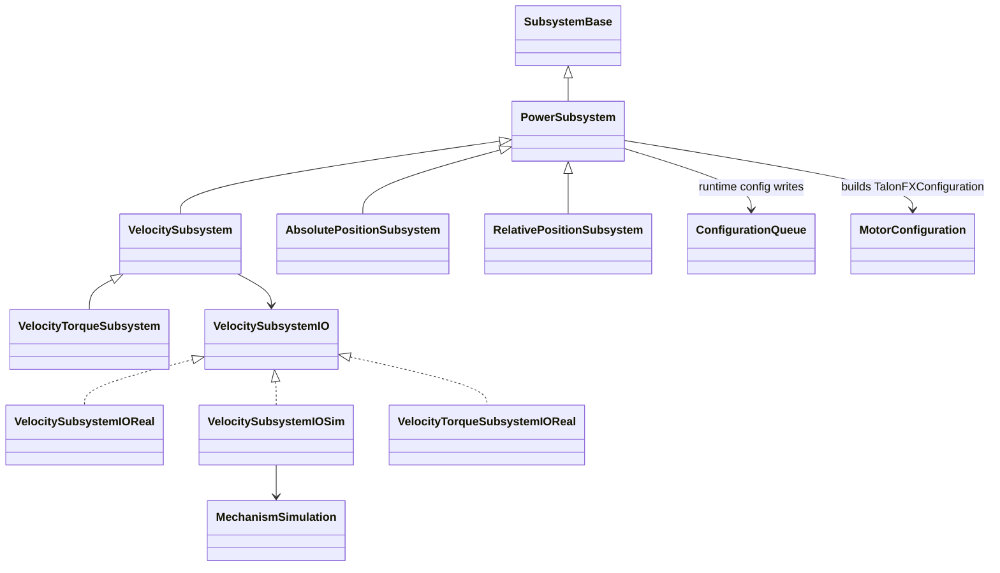

# Subsystems and IO

Reusable TalonFX mechanisms. The generator creates them from config records
([Code Generation Flow](../06-Data-Flows/Code%20Generation%20Flow.md)), and `StateMachine` owns them.
Folder: `templates/powerlib/src/main/java/frc/powerlib/subsystems/` (+ `io/`).

## `PowerSubsystem` (abstract base)
- **CAN and startup:** every device is on the `canivore` bus.
  - The first non-follower motor is the leader and gets the full closed-loop config. Followers get `Follower(leaderId, Aligned|Opposed)`.
  - Startup config uses a 0.05 s timeout. Any failure makes `isConfigured()` false for good and reports a DriverStation error. Setters do nothing while unconfigured.
- **No hardware in sim:** TalonFXs are created only when `!RobotBase.isSimulation()` and no custom IO was injected.
- **Tunables:** registers `Motors/<canId>/BrakeMode` and `Motors/<canId>/Reversed` for every motor. `getSubsystemVariable(...)` validates values and warns once per bad value, then keeps the current value.
- **Tuning cadence:** `shouldSyncTuning()` = tuning enabled AND own `TuningCadence` due (5 Hz).

## `ConfigurationQueue`: why it exists
CTRE `getConfigurator().apply()` blocks and can fail partway. Running it inside the 20 ms loop
for every live tuning change would stall the robot. The queue:
- runs writes on one daemon thread, `"PowerLib configuration"`;
- **coalesces** writes by key (`<deviceId>/<ConfigClass>`) and compares by `config.serialize()`;
- **retries** failures after 0.5 s;
- `request()` returns **true only once the requested value was actually applied**. Callers keep their cached values until then.

## `MotorConfiguration`
Pure builders with no hardware access:
- `output`: neutral mode and inversion.
- `closedLoop`: Slot0, ratios, Motion Magic.
- `velocity`: adds the optional stator current limit.
- `absolute`: adds a `FusedCANcoder` remote sensor.
- `relative`: adds soft limits.

## The mechanisms
| Class | Control | Published data | Notable tunables |
|---|---|---|---|
| `VelocitySubsystem` | `MotionMagicVelocityVoltage` (FOC optional) | `Velocity`, `VelocitySetpoint` (rps) | `PID/*`, `Feedforward/kS/kV/kA/Torque`, `Ratios/*`, `MotionMagic/*`, `Control/FOCEnabled` |
| `VelocityTorqueSubsystem` | `VelocityTorqueCurrentFOC` + torque FF when FOC, else velocity voltage | same | same |
| `AbsolutePositionSubsystem` | `MotionMagicVoltage` on a fused CANcoder (100 Hz signals) | `Position`, `SetpointRotations` (config units) | + `Cancoder/MagnetOffset`, `Cancoder/DiscontinuityPoint`, `Position/Default` |
| `RelativePositionSubsystem` | `MotionMagicVoltage` with NORMAL/SLOW profiles (SLOW when moving down) and soft limits | `Position`, `Setpoint`, `AtTarget` | + `SlowMotionMagic/*` |

- `RelativePositionSubsystem` waits until the profile config is acknowledged before sending a new target, holding position in the meantime. It zeroes to `homePosition` at startup.
- Public API examples: `setVelocity(rps)`, `setPositionRotations`, `setPosition`, `atTargetPosition()`, `setVoltage` (SysId), `stop()`.

## IO layer (`subsystems/io/`)
- Each mechanism talks to an `XxxSubsystemIO` interface (`updateInputs(inputs)`, setters).
- **Real** implementations drive the leader TalonFX. **Sim** implementations use `MechanismSimulation`: a deterministic 20 ms Kraken X60 model meant for tests, not a calibrated digital twin. PID gains are ignored in sim.
- Inject your own IO through the `(config, io)` constructors.
- Full MapleSim drivetrain physics comes from the [powerlib-sim Skill](../08-Skills/powerlib-sim%20Skill.md).

Related: [Configs](Configs.md), [Shared Data Store](Shared%20Data%20Store.md), [Tuning](Tuning.md), [Subsystem Generator](../02-Install-and-Update/Subsystem%20Generator.md)
