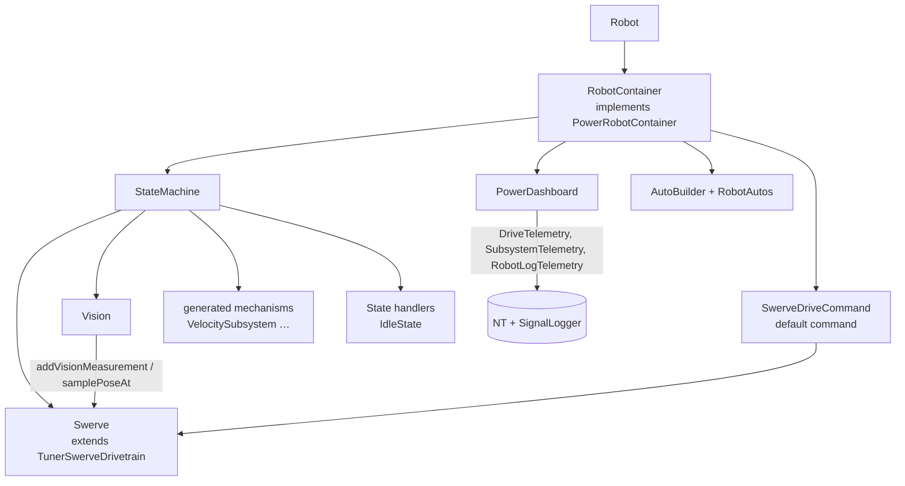

# Robot Templates

`templates/replacements/src/main/...` holds the starter `frc.robot` code written into a new
project. It shows how a robot uses PowerLib. Install rules (first-install backup, later
`.template` copies, create-only files) are in [Installer Flow](../02-Install-and-Update/Installer%20Flow.md).

## Root
- **`Constants.java`:** alias barrel (`class Swerve extends frc.robot.constants.SwerveConstants {}` …) plus the generator's marker block. Code reads `Constants.X.*`.
- **`RobotContainer.java`:** implements `frc.powerlib.PowerRobotContainer`.
  - Creates `StateMachine`, `PowerDashboard`, the driver `CommandXboxController` and `AutoBuilder`.
  - Sets `SwerveDriveCommand` as the default drive command.
  - `configureBindings()` is for your button bindings (`ButtonBindings` examples in comments).
  - `configureAutos()` calls `RobotAutos.register(...)`, then `autoBuilder.publish()`.
- **`autos/RobotAutos.java`:** your autonomous routines. **Create-only:** never overwritten.

## commands/
- **`RequestState`:** instant command that calls `stateMachine.requestState(state, owner)`.
- **`SwerveDriveCommand`:** teleop drive through `DriveUtil.calculateSpeedsBasedOnJoystickInputs` and `Swerve.drive(..., FIELD_RELATIVE)`. It gets `stateMachine::getCurrentState`.

## constants/
| File | Contents |
|---|---|
| `CanBusConstants` | `canivore` / `rio` bus names |
| `GeneratedTunableConstants` | `TunableConstants.register(...)` list. **Regenerated by the generator.** |
| `LEDConstants` | CANdle ID, strip start/length |
| `LocationConstants` | Field bounds (X 0–17.548 m, Y 0–8.052 m), used by the vision filter |
| `OIConstants` | Driver controller port, deadband, speed coefficients |
| `RobotContainerConstants` | Custom block only |
| `StateMachineConstants` | `DEFAULT_STATE = IDLE` |
| `SwerveConstants` | Driver feel, request deadbands, drive-to-point, heading PID. **Regenerated from the JSON `swerve` section.** |
| `TunerConstants` | CTRE Tuner X output; `createDrivetrain()` returns `new Swerve(...)` |
| `VisionConstants` | `LIMELIGHT_NAMES` plus vision configs; see [Vision Pipeline](../03-PowerLib/Vision%20Pipeline.md) |

## subsystems/
- **`StateMachine`:** the central subsystem.
  - Owns `Swerve`, `Vision`, the generated mechanisms (marker block) and the `states` handler list (registration order = priority).
  - Requests are stored per owner. Details: [State Machine and Controls](../03-PowerLib/State%20Machine%20and%20Controls.md).
- **`PowerDashboard`:** the robot's NT and telemetry hub.
  - `periodic()` runs: `driveTelemetry.publish`, the tuning-mode handshake, `SubsystemTelemetry.publish()`, `robotLogTelemetry.log`, tuning value sync, characterization polling.
  - NT tables live under `/PowerLib/Subsystems|Commands|Tuning|Characterization`.
  - The generator keeps a reference copy in `power-tool/scripts/templates/`. See [Telemetry Flow](../06-Data-Flows/Telemetry%20Flow.md).
- **`Swerve`:** `extends TunerSwerveDrivetrain implements Subsystem`.
  - 15 live tunables (Driver/Requests/DriveToPoint/Heading). Drive modes: robot-relative, field-relative, SysId, rotation lock, drive-to-point.
  - `poseResetVersion` is bumped on every reset. `addVisionMeasurement` converts FPGA time with `Utils.fpgaToCurrentTime`.
  - Configures PathPlanner from `deploy/pathplanner/settings.json`. Runs a 5 ms sim notifier.
- **`Vision`:** uses the full PowerLib vision stack with a `Swerve`. Logs `Vision/...` keys to SignalLogger. Public API: `seedFromFreshVision`, `setShouldUpdatePose`, `isHeadingEstablished`, `hasFreshAcceptedMeasurement`.
- **`LED`:** CANdle wrapper. Not created by default.
- **`states/IdleState`:** the starter `State<RobotState, StateMachine>` handler.

## Other
- `utils/FieldUtils.java`: stub (`getZone` always returns `NEUTRAL`).
- `deploy/pathplanner/settings.json`: PathPlanner robot config (mass, MOI, module offsets…).
- `templates/vendordeps/maple-sim-0.4.0-beta.json`: the pinned MapleSim vendordep.

Related: [Installer Flow](../02-Install-and-Update/Installer%20Flow.md), [Subsystem Generator](../02-Install-and-Update/Subsystem%20Generator.md), [State Machine and Controls](../03-PowerLib/State%20Machine%20and%20Controls.md), [Telemetry Flow](../06-Data-Flows/Telemetry%20Flow.md), [Vision to Pose Flow](../06-Data-Flows/Vision%20to%20Pose%20Flow.md)
