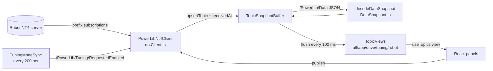

# NetworkTables Layer

How Power Tool talks to the robot. Files: `powerlib-dashboard/src/networktables/*` and
`src/features/networktables/NetworkTablesContext.tsx`.

## `nt4Client.ts`: `PowerLibNt4Client`
A wrapper over the `ntcore-ts-client` library, not a hand-written websocket client.
- `connect(host, port, cb)` / `disconnect()`. Reconnect uses the library's auto-connect. Each new connection bumps `connectionRevision` and resets clock sync.
- `watchPrefix(prefix, onValue, intervalMs = 100)`: prefix subscription with `all: false`, so only the latest value per period arrives.
- `publish(name, "boolean"|"double"|"int"|"string", value)`: waits up to 250 ms for the announce and rejects writes from a stale connection.
- `watchCameraAnnouncements()`: topics-only subscription to `/` that finds camera tables from raw announce messages.
- Patches the library so custom types (`struct:Pose2d`) and raw byte values don't break announcement batches.
- Connection presets (team 9410 addresses are hardcoded): `localhost:5810` (sim, the default), `10.94.10.2`, `roborio-9410-frc.local`, `10.94.10.5`, custom. Saved in localStorage `powerlib.connectionSettings`.

## Timing (`telemetryTiming.ts`)
- `telemetryUpdateIntervalMs = 100`: telemetry subscriptions and screen refresh at 10 Hz.
- `tuningUpdateIntervalMs = 200`: tuning at 5 Hz.

## The telemetry frame (`DataSnapshot.ts`)
- `/PowerLib/Data` is one JSON string per 100 ms: `{schemaVersion: 1, sequence, timestampSeconds, subsystems: {Name: {key: value}}}`.
- `decodeDataSnapshot` turns each field into a synthetic topic `/PowerLib/Subsystems/<Name>/Data/<key>`:
  - numbers → `double`, `null` → `double` with a null value;
  - booleans and strings keep their type;
  - pose objects `{xMeters, yMeters, headingRadians}` → `struct:Pose2d` (24-byte float64 buffer).
- If any part of a frame is invalid, the whole frame is rejected.
- Contract: `tests/TELEMETRY-CONTRACT.md`. Robot side: [Telemetry and Logging](../03-PowerLib/Telemetry%20and%20Logging.md).

## `TopicSnapshotBuffer.ts`
- Sits between NT callbacks and React and keeps **only the latest value per topic**.
- Each valid frame **replaces** all subsystem data: removed fields disappear, and legacy per-field topics are ignored once frames arrive.
- An invalid frame sets `telemetryError` and keeps the last good data.

## `TopicViews.ts` and `NetworkTablesContext.tsx`
- Views: `all`, `app` (tuning, characterization, cameras), `drive`, `tuning`, `robot`. A view's array only changes when its contents change, so panels don't re-render on unrelated traffic.
- `NetworkTablesProvider` owns one client, one buffer and one set of views. A single 100 ms interval flushes into the views; the tuning view refreshes every 200 ms.
- Hooks: `useNetworkTables()` returns `{clientRef, status, connectionSettings, telemetryError, setTopics, upsertTopic, pruneTopics, …}`. `useTopics(view)` is a `useSyncExternalStore` over a view.
- **No history is kept.** A live plot or recorder would need its own ring buffer per topic.

## `TuningModeSync.ts`
Publishes the switch the user wants to `/PowerLib/Tuning/RequestedEnabled` until the robot echoes
it on `/PowerLib/Tuning/Enabled`. It resends after reconnects and robot reboots. See
[Tuning](../03-PowerLib/Tuning.md).

## Watched prefixes (`App.tsx`)
- At 100 ms: `/PowerLib/Data`, `/PowerLib/Subsystems/Drive/Data/`, `/PowerLib/Subsystems/Swerve/Data/`, `/PowerLib/Drive/`, `/PowerLib/Characterization/`, `/SmartDashboard/`, `/Robot/`, `/CameraPublisher/`, `/limelight`.
- At 200 ms: `/PowerLib/`.
- `/` only while the NetworkTables tab is open.

Related: [Power Tool Architecture](Power%20Tool%20Architecture.md), [Telemetry Flow](../06-Data-Flows/Telemetry%20Flow.md), [Tuning Round Trip](../06-Data-Flows/Tuning%20Round%20Trip.md), [Tabs and Features](Tabs%20and%20Features.md)
