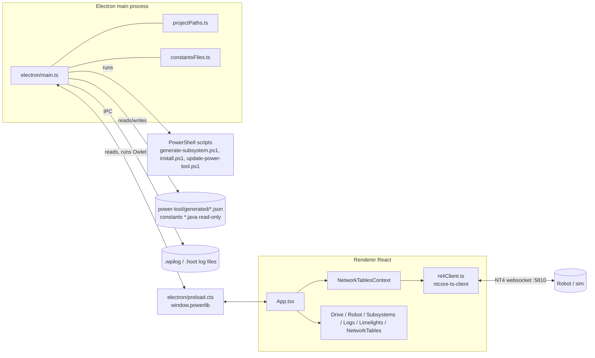

# Power Tool Architecture

Power Tool is the team's desktop dashboard: an **Electron** app with a **React 19 + MUI** renderer,
built with **Vite** and **TypeScript**. Source lives in `powerlib-dashboard/`. The installer copies
it into a robot project as `<robot>/power-tool/` and builds it there
(see [Power Tool Update Flow](../02-Install-and-Update/Power%20Tool%20Update%20Flow.md)).

## Build and run

| Script (`powerlib-dashboard/package.json`) | What it does |
|---|---|
| `npm run dev` | Builds electron, starts Vite on `127.0.0.1:5173`, launches Electron against it |
| `npm run build` | `tsc` type-check → `vite build` to `dist-renderer/` → `tsc -p tsconfig.electron.json` to `dist-electron/` |
| `npm start` | `electron .` runs the built app (what the installed launchers call) |
| `npm run package:app` / `package:publish` | Calls `../build-dashboard.ps1` → electron-builder `--dir` into `PowerTool-local/` or `PowerTool/` |
| `npm run check:*` | Node check scripts; see [Tests and Checks](../07-Testing/Tests%20and%20Checks.md) |

- Key dependencies: `ntcore-ts-client` 3.1.3 (pinned NT4 client), `@mui/material` 9, `electron` 39, `electron-builder`, `zod` (patches the NT library's schemas).
- **No charting library.** The Logs tab draws its graphs as plain SVG.
- `index.html` sets a strict CSP: `script-src 'self'`; `connect-src 'self' ws: wss:` plus localhost http. The Logs tab parses on the main renderer thread, so it needs no CSP changes. Moving parsing to a worker or blob may.
- electron-builder: appId `org.team9410.powerlib.powertool`. Every platform builds an unpacked `dir` target (no installer).

## Main process (`electron/main.ts`)

- Window 1180×780 (min 960×640), `contextIsolation: true`, `nodeIntegration: false`. External links open in the system browser.
- **Robot root detection** (`getDetectedRobotRoot`): walks up to 8 levels from cwd, app path and `__dirname` until it finds a folder with `build.gradle`, `settings.gradle`, `src/main/java` or `power-tool/scripts/generate-subsystem.ps1`.
- **File menu:** Connection Settings, Update Code, Update PowerLib Library Files, Update Vendor Dependencies, Update Power Tool.

### IPC channels

| Channel | Purpose |
|---|---|
| `powerlib:read-subsystems` / `save-subsystems` | Read and merge-write `power-tool/generated/powerlib-subsystems.json` |
| `powerlib:read-constants` / `save-constants` | `constantsFiles.ts`: parse `*Constants.java`, save edits to `powerlib-constants.json` (**never rewrites Java**) |
| `powerlib:update-subsystem-code` | Runs `generate-subsystem.ps1 -UpdateSubsystems -SubsystemsJson …` ("Update Code") |
| `powerlib:update-install-section` | Runs `install.ps1` non-interactively for `lib` or `vendordeps`, using the ref in `.powerlib-repo-ref` |
| `powerlib:update-power-tool` | Launches `update-power-tool.ps1` detached in a console, then quits the app |
| `powerlib:open-log` | File dialog for `.wpilog`/`.hoot`; returns the file bytes (`.hoot` converted first, see below) |
| `powerlib:open-log-path` | Same, for a dropped file's path. Only accepts `.wpilog`/`.hoot` paths |
| `powerlib:read-drive-motor-ids` | Swerve drive/steer motor CAN IDs from the robot's `TunerConstants.java` (`src/main/java/frc/robot/{constants,generated,}/`), for grouping a log's Drive motors |
| `powerlib:menu-*` (main → renderer) | Menu clicks forwarded to React |

`preload.cts` exposes these as `window.powerlib` (types in `src/types/electron.d.ts`), plus
`getPathForFile` (Electron `webUtils`) so a dropped `.hoot` can be handed to the main process.

**`.hoot` conversion** (`readLogFile` in `main.ts`, `convertHoot` in `electron/owlet.ts`) runs CTRE's
Owlet (`owlet <in> <out> -f wpilog -s <ids>`) into a temp folder that is deleted afterwards. The IPC
result is `files: [{ name, bytes }]`, one per log file.
- **Whole session:** opening one `.hoot` also converts every `.hoot` in the same folder with the same `_YYYY-MM-DD_HH-MM-SS` suffix (`sessionSiblings`). SignalLogger writes one per CAN bus, and they share one clock. The roboRIO bus's file comes first.
- **Only needed signals:** a full CANivore export is ~1 GB (2,000+ device signals). `convertHoot` runs `owlet <hoot> --scan` first, then exports only robot-written and Owlet status signals plus each Talon FX's `SupplyCurrent`, `SupplyVoltage`, `MotorVoltage`, `StatorCurrent`, `DeviceTemp` and `Position` (for matching motors by motion) (`isViewerSignal`, `pickSignalIds`). On a 2026 match this was ~130 MB and 2.5 s. If the scan fails, everything is exported.
- **Version matching:** each Owlet reads one `.hoot` format version ("compliancy"), and CTRE changes the format between Phoenix releases.
  1. `convertHoot` asks an Owlet for the log's version with `owlet <hoot> --compliancy`, which prints `owlet: N` / `hoot log: N`.
  2. It then runs the Owlet with the same number. AdvantageScope names its copies `owlet-<ver>-C<N>.exe`; other copies are asked.
- **Where Owlets are found:**
  1. the `POWERLIB_OWLET` environment variable;
  2. `owlet*` executables in `<robot>/power-tool/tools/`, `<robot>/tools/`, a Power Tool root's `tools/`, and **AdvantageScope's cache** (`%APPDATA%/AdvantageScope/owlet`, i.e. `app.getPath("appData")`);
  3. `where owlet` / `which owlet` (PATH).

  AdvantageScope downloads the matching Owlet the first time it opens a `.hoot`, so a laptop that has used AdvantageScope usually needs nothing else.
- If no Owlet or no matching version is found, the error says so and points to AdvantageScope or CTRE's download page. `.wpilog` files never need Owlet.

### Helper modules
- `projectPaths.ts`: `generatedJsonPath()` always resolves to `<robot>/power-tool/generated/<file>`. Old root-level copies are migrated there, and conflicting duplicates go to `generated/legacy/`.
- `constantsFiles.ts`: finds subsystem and robot `*Constants.java` targets and parses `public static final|volatile` declarations at class depth 1, including the custom-constants marker block. It overlays saved JSON and Swerve defaults, validates edits, and writes JSON atomically. Details: [Tuning Round Trip](../06-Data-Flows/Tuning%20Round%20Trip.md).

## Renderer

- `src/main.tsx`: MUI dark theme (primary `#facc15`) → `<App/>`.
- `src/App.tsx`: `NetworkTablesProvider` → `AppContent`, which holds the app bar (tuning switch, connect, host chip), the tabs, the global dialogs and the toast. It also owns the connection, prefix watches, the subsystem document and Update Code calls. See [Tabs and Features](Tabs%20and%20Features.md).
- `src/types/app.ts`: `AppView = "drive" | "robot" | "subsystems" | "limelights" | "networktables" | "logs"`. Add a new value here to add a tab.
- NetworkTables plumbing: [NetworkTables Layer](NetworkTables%20Layer.md).

Related: [NetworkTables Layer](NetworkTables%20Layer.md), [Tabs and Features](Tabs%20and%20Features.md), [Custom Dashboard](Custom%20Dashboard.md), [Telemetry Flow](../06-Data-Flows/Telemetry%20Flow.md), [Project Overview](../11-Ideas/INDEX.md)
