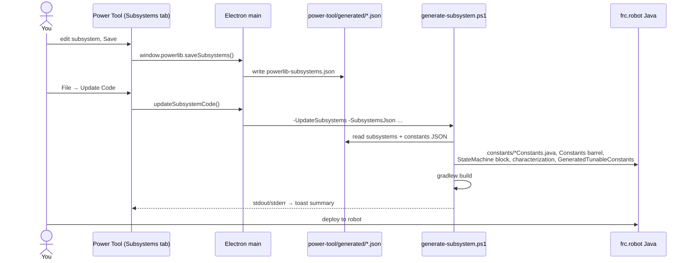

# Code Generation Flow

How a subsystem goes from a form in Power Tool to running Java on the robot.

1. **Edit:** the Subsystems tab writes **only JSON**. Saving never touches Java.
2. **Update Code:** runs the generator, which turns the JSON into Java. See [Subsystem Generator](../02-Install-and-Update/Subsystem%20Generator.md) for the exact order.
3. **Robot:** `StateMachine` now holds `new VelocitySubsystem(Constants.X.X_CONFIG)`. The config record feeds the subsystem and its IO layer ([Subsystems and IO](../03-PowerLib/Subsystems%20and%20IO.md)).
4. **Deploy:** the new subsystem publishes data under `/PowerLib/Subsystems/<Name>/…`, and Power Tool's Robot tab shows it as a card ([Telemetry Flow](Telemetry%20Flow.md)).

The source of truth is the JSON in `power-tool/generated/`. The generator overwrites hand edits to
generated sections. Keep custom code inside the `POWERLIB CUSTOM CONSTANTS` blocks.

Related: [Subsystem Generator](../02-Install-and-Update/Subsystem%20Generator.md), [Tuning Round Trip](Tuning%20Round%20Trip.md), [Tabs and Features](../05-Power-Tool/Tabs%20and%20Features.md)
