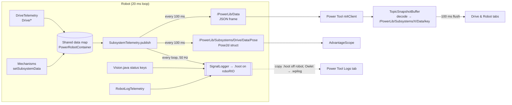

# Telemetry Flow

One shared map feeds two outputs: a **50 Hz log** on the robot and a **10 Hz NT frame** for Power Tool.

## What goes where
| Data | SignalLogger (.hoot) | NT `/PowerLib/Data` | Power Tool (live) | Logs tab |
|---|---|---|---|---|
| Every shared-map metric (all owners) | ✅ 50 Hz, typed, with units | ✅ 10 Hz, no units | ✅ latest value only | ✅ mechanisms, battery, CAN, state |
| `Drive/Pose` | ✅ struct (valid only) | ✅ `{xMeters,yMeters,headingRadians}` or null | ✅ field view | ✅ field + trail |
| `PowerLib/RobotStatus/*` (DS/FMS/brownout…) | ✅ | ❌ | ❌ | `BrownedOut` → markers |
| `Vision/*` status, `Robot/Control/Action` | ✅ | ❌ | ❌ | ❌ not shown yet |
| Phoenix device signals (auto-logged) | ✅ | ❌ | ❌ | ❌ not shown yet |
| Tuning variables, auto chooser, cameras | ❌ | separate NT topics | ✅ | ❌ |

The Logs tab reads the same keys from a `.wpilog` (or a `.hoot` converted by Owlet). It also
reads `/PowerLib/Data` frames if a log only has those, e.g. a WPILib `DataLogManager` log.

## Steps
1. Subsystems and `DriveTelemetry` write their latest values into the [Shared Data Store](../03-PowerLib/Shared%20Data%20Store.md).
2. `PowerDashboard.periodic()` calls `SubsystemTelemetry.publish()` every loop:
   - it always logs the map to SignalLogger;
   - every 100 ms it also builds the JSON frame (`sequence` +1) and publishes it.
3. Power Tool subscribes at 100 ms. `DataSnapshot` decodes the frame into synthetic per-field topics. `TopicSnapshotBuffer` **replaces** the previous frame, so removed fields disappear.
4. Panels re-render through `useTopics(view)` on a 100 ms flush.

Details: [Telemetry and Logging](../03-PowerLib/Telemetry%20and%20Logging.md) (robot side),
[NetworkTables Layer](../05-Power-Tool/NetworkTables%20Layer.md) (dashboard side). Both sides are
checked against the same fixture frame (see [Tests and Checks](../07-Testing/Tests%20and%20Checks.md)).

Related: [Project Overview](../11-Ideas/INDEX.md), [Tuning Round Trip](Tuning%20Round%20Trip.md)
