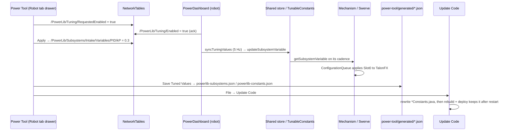

# Tuning Round Trip

How a value goes from a live edit to a permanent default in Java.

## Two kinds of edits
1. **Live (NT):**
   - Needs tuning ON and the robot's acknowledgement.
   - Lost on robot restart.
   - **There's no guaranteed end-to-end delay.** The edit passes through several independent stages:
     - `PowerDashboard` copies NT values into the store on its 5 Hz pass;
     - the mechanism reads them on its own 5 Hz `TuningCadence`;
     - CTRE settings then go through `ConfigurationQueue`, which writes on a background thread with a 50 ms timeout and retries failures no sooner than 500 ms later.

     A software-only value (e.g. a `Custom/` constant) usually lands within a few hundred ms. A motor config change lands only after the TalonFX acknowledges it, and a failing write keeps retrying while it's still requested. Power Tool shows the published value, not proof that it was applied.
2. **Saved (JSON):** "saved-only" constants, or **Save Tuned Values**.
   - Writes `power-tool/generated/*.json` through Electron IPC. Java is not touched.
   - **Update Code** regenerates the Java. Then rebuild and deploy.

## Where values map
| Live variable | Saved location |
|---|---|
| `/Variables/PID/kP`, `Feedforward/*`, `MotionMagic/*`, `Ratios/*`, `Motors/<id>/BrakeMode` … | that subsystem's entry in `powerlib-subsystems.json` |
| `Swerve/Variables/Driver/*`, `Requests/*`, `DriveToPoint/*`, `Heading/kP…` | `powerlib-subsystems.json` → `swerve` |
| `<Owner>/Variables/Custom/<CONST>` (`@TunableConstant` fields) | `powerlib-constants.json` → `files["robot:<Owner>"]` or `["subsystem:<id>"]` |

Code: `RobotTuningDrawer.tsx`, `SaveTunedValuesDialog.tsx`, `TuningModeSync.ts`,
`electron/constantsFiles.ts`, template `PowerDashboard.java`, `frc/powerlib/tuning/*`.

Related: [Tuning](../03-PowerLib/Tuning.md), [Tabs and Features](../05-Power-Tool/Tabs%20and%20Features.md), [Code Generation Flow](Code%20Generation%20Flow.md), [Subsystem Generator](../02-Install-and-Update/Subsystem%20Generator.md)
