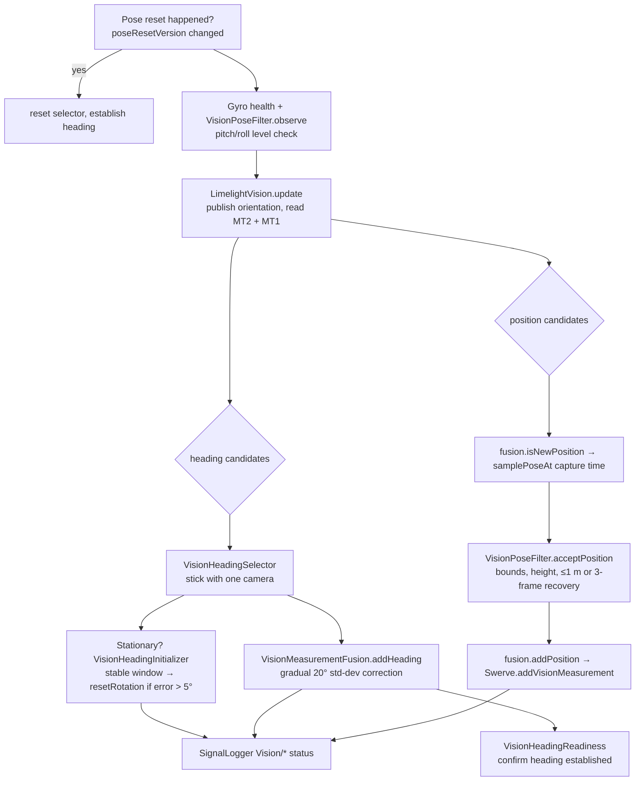

# Vision to Pose Flow

What the template `Vision.periodic()` does each 20 ms loop to correct the `Swerve` pose estimator.

## Key rules
- **Position fusion waits until heading is trusted.** Heading becomes trusted through disabled initialization, stationary recovery, fusion readiness, or an explicit reset.
- **MT2 frames captured before a heading correction is published are discarded.** They used the old heading.
- **Test mode** suppresses heading init and correction. `setShouldUpdatePose(false)` suppresses everything, but frames are still consumed.
- **History lookup:** `Swerve.samplePoseAt` and `addVisionMeasurement` convert FPGA time with `Utils.fpgaToCurrentTime`.

Class details: [Vision Pipeline](../03-PowerLib/Vision%20Pipeline.md). Thresholds: [Configs](../03-PowerLib/Configs.md).

Related: [Vision Pipeline](../03-PowerLib/Vision%20Pipeline.md), [Robot Templates](../04-Robot-Templates/Robot%20Templates.md), [Telemetry and Logging](../03-PowerLib/Telemetry%20and%20Logging.md)
